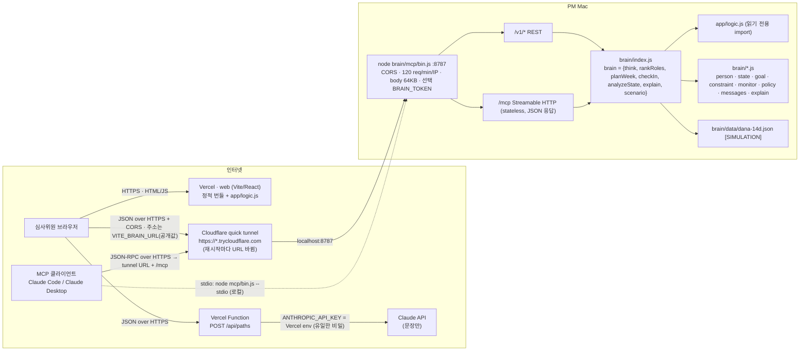
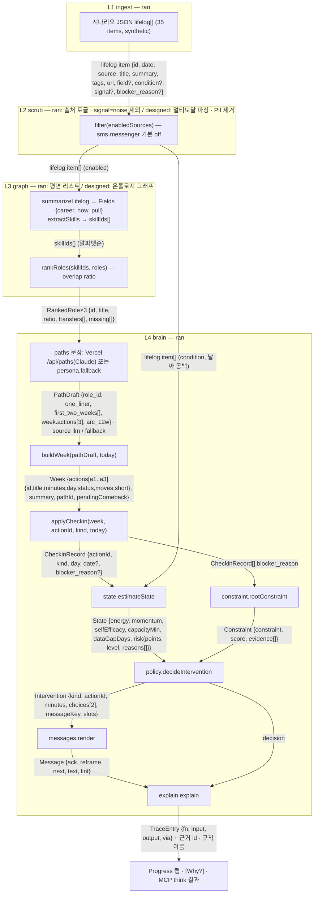
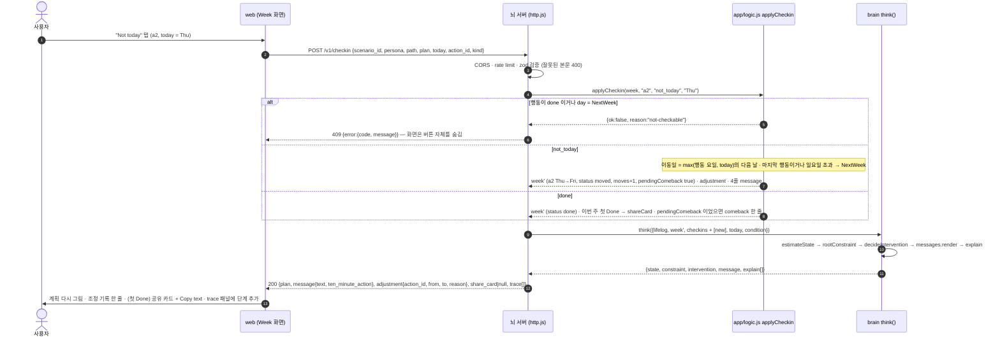
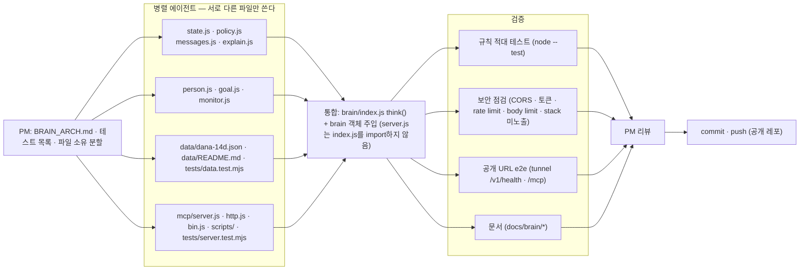

# Second Draft — 데이터 흐름도 (DATAFLOW) · 공개 문서 · 2026-10-24 · 팀 KPK2

> 배치·런타임·체크인 시퀀스·think() 내부·개발 흐름·경로↔함수 표. 그림은 Mermaid(GitHub 렌더) + 터미널용 ASCII.
> 근거: `BRAIN_ARCH.md`(모듈·think 9단계) · `ARCHITECTURE.md`(6층 L0–L5) · `docs/logic-contract.md`(`app/logic.js` 입출력) · Build 규격 §3.2–3.4·§4(web ↔ 뇌 서버 HTTP 계약) · `brain/` 소스.
> 원칙: **판단은 결정론 규칙(`app/logic.js` + `brain/`), LLM은 문장만**. 뇌 서버는 LLM을 부르지 않는다. 데모 데이터는 전부 합성(`"_label": "synthetic"`, `[SIMULATION]`).
> 표기: `구현` = 지금 코드에 있음 · `규격` = Build 규격 §4의 계약(연결 대상) · `설계` = 오늘은 돌지 않음(화면에 "designed"로 표시).

## 1. 전체 배치도



```
[VC 브라우저] --HTTPS--> [Vercel web: Vite/React + app/logic.js]
   |--JSON/HTTPS--> [Vercel /api/paths] --ANTHROPIC_API_KEY(Vercel env만)--> [Claude: 문장만]
   '--JSON/HTTPS + CORS (VITE_BRAIN_URL)--> [Cloudflare tunnel https://*.trycloudflare.com]
[MCP 클라이언트] --JSON-RPC/HTTPS--> <tunnel>/mcp --------------------------'  | localhost:8787
[MCP 클라이언트] --stdio: node mcp/bin.js --stdio ---------------------------> [Mac: node brain/mcp/bin.js]
                                                      /v1/* REST · /mcp Streamable HTTP
                                                      -> brain/index.js -> app/logic.js + brain/*.js + data/dana-14d.json
비밀: Claude 키 1개, Vercel env에만. 뇌 서버에는 키가 없다(LLM 호출 0). BRAIN_TOKEN은 선택 접근 제어(기본 off).
```

- 홉별 적재물: 브라우저→Vercel은 정적 자산, 브라우저→`/api/paths`와 브라우저→터널은 JSON/HTTPS(터널 쪽은 교차 출처라 CORS 필요, `BRAIN_CORS_ORIGINS` 기본 `*`), MCP는 JSON-RPC(원격 Streamable HTTP, 로컬 stdio). 레포·브라우저 번들·뇌 서버 어디에도 API 키가 없고, `VITE_BRAIN_URL`은 공개 주소이지 비밀이 아니다.

## 2. 런타임 데이터 흐름 (L1–L4)

웹 처리 과정 패널의 L1–L4는 규격 §3.3·§4.1의 trace step `{layer, stage, label, status, input_summary, output_summary, ms}` 기준이다. 6층 문서와의 대응: 문서 L0 커넥터 = 오늘 `설계`(trace에 없음) · 문서 L1 게이트웨이 = trace L1 `ingest` · 문서 L2 파싱·필터 = trace L2 `scrub` · 문서 L3 온톨로지 = trace L3 `graph` · 문서 L4 Brain = trace L4 `interview|paths|plan|checkin|adjust` · 문서 L5 인터페이스 = 웹 화면 자체. 화면은 서버가 보내지 않은 단계를 지어내지 않는다.



```
L1 lifelog item[] --filter(enabledSources, noise)--> L2 enabled item[]
  --summarizeLifelog/extractSkills--> L3 Fields + skillIds[] --rankRoles--> RankedRole x3
  --/api/paths (llm | fallback)--> PathDraft x3 --buildWeek(today)--> Week
  --applyCheckin(done | not_today)--> CheckinRecord --estimateState--> State{risk}
  --rootConstraint--> Constraint --decideIntervention--> Intervention --render--> Message
  --explain--> TraceEntry[] (근거 lifelog/checkin id + 규칙 이름) --> 화면 trace 패널 · [Why?]
```

- 판단 값(겹침 비율·이동 요일·위험 점수·개입 종류)은 전부 L3·L4의 순수 함수가 낸다. LLM 출력은 `PathDraft`의 문장뿐이고, 검증 실패 시 `source: fallback`으로 표시된다(`web/api/paths.js`).
- 현재 `web/src`는 위 L3·L4의 `logic.*` 호출을 브라우저에서 직접 하고(`withTrace`로 `TraceEntry` 생성) `/api/paths`만 서버로 보낸다. 규격 §3.5의 "모든 연산은 뇌 서버 호출"은 `VITE_BRAIN_URL` 연결(§6 표의 `규격` 행)로 옮겨 가는 목표 상태다.

## 3. 시퀀스: 하루 체크인



```
사용자 --Not today--> web --POST /v1/checkin {path, plan, today, action_id, kind}--> 뇌 서버
  뇌 서버 --applyCheckin--> logic : done/NextWeek 행동이면 ok:false -> 409
                                    not_today: max(행동 요일, today)+1일, 마지막 행동/일요일 초과 -> NextWeek, moved, moves+1
                                    done: status done, 첫 Done -> shareCard, Not today 뒤 첫 Done -> comeback
  뇌 서버 --think(week', checkins+1)--> state -> constraint -> policy -> messages -> explain
  뇌 서버 --200 {plan, message, adjustment, share_card, trace}--> web --> 화면 갱신
```

- 서버는 대화를 기억하지 않아도 된다. 화면이 `plan` 전체를 매 요청에 보내고(규격 §4.1) 서버는 새 `plan`을 돌려주며, `action.id`·`path_id`는 바뀌지 않는다. 공유 카드에는 경로 이름·끝낸 행동·`n/3 done`만 들어간다(개인 정보·분·다른 수치 없음).

## 4. think() 내부 파이프라인 (BRAIN_ARCH.md §2)

```mermaid
flowchart LR
  IN["입력 (화면 상태 그대로)<br/>{fields, lifelog, enabledSources, rankedRoles, path, week, checkins, condition, today}"]
  S1["① logic.summarizeLifelog · extractSkills · rankRoles<br/>→ Fields · skillIds[] · RankedRole[]"]
  S2["② person.buildPersonModel<br/>→ {traits:{careerCapital, archetype, stageOfChange}, evidence[]}"]
  S3["③ state.estimateState<br/>→ {energy, momentum(EWMA), selfEfficacy, capacityMin, dataGapDays, risk}"]
  S4["④ goal.goalState · milestones · nextQuestion<br/>→ ambiguous/provisional/validated · 게이트 4(Fit·Proof·Market·Ready) · 질문 1"]
  S5["⑤ constraint.rootConstraint<br/>→ {constraint: COM-B 5종 또는 unknown, evidence[]}"]
  S6["⑥ monitor.compareWeek<br/>→ {onTrack, drift[], plateau}"]
  S7["⑦ policy.decideIntervention<br/>→ {kind: full/shrink/rest/reconnect/comeback/gate/none, actionId, minutes, choices[2], messageKey}"]
  S8["⑧ messages.render(messageKey, slots)<br/>→ {ack, reframe, next, text, lint} · 금지어 0"]
  S9["⑨ explain.explain(decision, inputs)<br/>→ 근거 lifelog/checkin id + 규칙 이름 (TraceEntry 형식)"]
  OUT["출력: Brain 리포트 1개<br/>{person, state, goal, constraint, monitor, intervention, message, explain[]}"]
  IN --> S1 --> S2 --> S3 --> S4 --> S5 --> S6 --> S7 --> S8 --> S9 --> OUT
```



```
입력 -> ①logic(summarize·skills·rank) -> ②person -> ③state -> ④goal -> ⑤constraint
     -> ⑥monitor -> ⑦policy -> ⑧messages -> ⑨explain -> Brain 리포트 1개
```

- 전부 순수 함수(DOM·네트워크·시계 없음). `today`·`condition`은 입력이며 추정하지 않는다(없으면 `null`/`unknown`). 같은 입력 → 같은 출력이고 Progress 탭·[Why?]·MCP `think`가 같은 리포트를 받는다. `index.js`(`think`와 brain 객체 조립)는 작성 중이며, `mcp/bin.js`는 `think · rankRoles · planWeek · checkIn · analyzeState · explain` export가 없으면 기동을 거부한다.

## 5. 멀티 에이전트 개발 흐름 (오늘 brain/ 작업 방식)



```
PM 설계 -> [state/policy/messages/explain | person/goal/monitor | 시나리오 데이터 | MCP 서버] 병렬
        -> index.js 통합 -> [적대 테스트 | 보안 | 공개 URL e2e | 문서] -> PM 리뷰 -> commit/push
```

- 소유 파일이 겹치지 않아 충돌 없이 병렬이 가능했고, 통합점은 `index.js` 하나다. MCP 층은 가짜 brain으로 먼저 테스트하고 실제 brain을 나중에 주입한다(`server.js` 머리말 계약). `app/logic.js`·`web/`는 Build 소유라 건드리지 않는다.

## 6. 경로 · 도구 ↔ 함수 매핑

| 표면 | 경로 / 도구 | 상태 | 부르는 함수 | 응답 |
|---|---|---|---|---|
| web ↔ 뇌 (규격 §4.2) | `POST /v1/interview` | 규격 | `goal.nextQuestion` · `person.buildPersonModel` (+ 시나리오 대사) | `{reply{text}, ready_for_paths, trace[]}` |
| | `POST /v1/paths` | 규격 | `summarizeLifelog` · `extractSkills` · `rankRoles` → 문장은 LLM 또는 `fallback` | `{paths: Path×3, trace[]}` |
| | `POST /v1/plan` | 규격 | `buildWeek` · `sizeForCondition` · `goal.milestones` | `{plan: Plan, trace[]}` |
| | `POST /v1/checkin` | 규격 | `applyCheckin` → `think` (state → constraint → policy → messages → explain) | `{plan, message, adjustment, share_card, trace[]}` · 거절 `409` |
| | `POST /v1/voice/token` | 규격(선택) | 뇌 함수 없음 — 음성 인식 1회 토큰(키는 서버에만) | `{token, expires_at}` |
| 뇌 REST (`mcp/http.js`) | `GET /v1/health` · `GET /v1/scenario` | 구현 | — · `brain.scenario` | `{ok, name, version, tools[], uptimeSec}` · 시나리오 JSON |
| | `POST /v1/think` · `/v1/rank-roles` · `/v1/plan-week` · `/v1/check-in` · `/v1/analyze-state` · `/v1/explain` | 구현 | `brain.think` · `rankRoles` · `planWeek` · `checkIn` · `analyzeState` · `explain` (zod 검증은 MCP 도구와 동일) | 함수 반환값 그대로 · 오류 `{error:{code, message}}` |
| MCP (`mcp/server.js`) | tools `think` · `rank_roles` · `plan_week` · `check_in` · `analyze_state` · `explain` · `get_scenario` | 구현 | 위와 같은 brain 함수 (REST와 1:1) | `content[text JSON]` + `structuredContent` |
| | resource `brain://scenario/dana` · prompt `brain-dump` | 구현 | `brain.scenario` · `rank_roles` 유도 프롬프트 | JSON · 메시지 1개 |
| Vercel (`web/api/paths.js`) | `POST /api/paths` | 구현 | Claude 1회(`ANTHROPIC_API_KEY`) → 검증 실패·시간 초과·키 없음이면 `persona.fallback` | `{source: llm / fallback, paths: PathDraft[]}` |
| 브라우저 (`web/src`) | `@app/logic.js` 직접 import | 구현 | `summarizeLifelog` · `mergePrefill` · `extractSkills` · `rankRoles` · `buildWeek` · `applyCheckin` · `sizeForCondition` · `progressSignals` (`withTrace`) | 화면 상태 + `TraceEntry[]` |

- 규격 경로(`/v1/checkin`, 본문 `Plan` 모양)와 구현 경로(`/v1/check-in`, 본문 `{week, actionId, kind, today, checkins, lifelog, condition}`)는 이름과 모양이 다르다. web을 `VITE_BRAIN_URL`로 붙일 때 어느 쪽이 맞출지(별칭 경로 또는 어댑터) 미결 — HANDOFF 「제안」으로 올린다.
- 어느 표면으로 들어와도 판단 함수는 같다(`app/logic.js` + `brain/`). 이것이 "코어 하나, 껍데기 셋(web · REST · MCP)"의 코드 증명이다.
